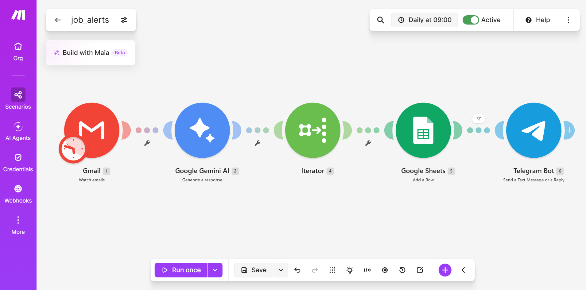
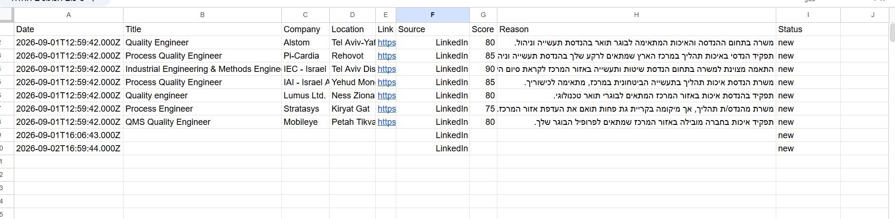
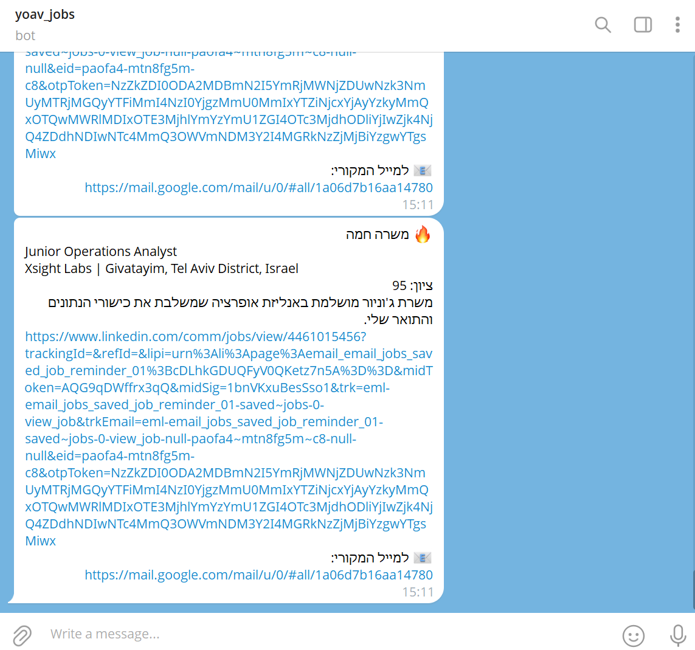

# Job Hunt Copilot – AI Job-Matching Automation

An automated pipeline built in **Make.com** that reads job-alert emails, uses **Google Gemini** to extract each listing and score how well it fits my CV, logs every job to **Google Sheets**, and sends a **Telegram** alert for high-match roles.

## The problem
Job sites (LinkedIn, Drushim, AllJobs) send many alert emails, and most of the listings are not relevant. Going through them by hand takes time, and good roles get missed.

## How it works

```
Gmail → Gemini → Iterator → Google Sheets → Filter (score ≥ 70) → Telegram
```

| # | Module | What it does |
|---|--------|--------------|
| 1 | Gmail – Watch emails | Picks up new job-alert emails (labeled `job-alerts`, from 2025 onward) |
| 2 | Google Gemini AI | Extracts every job (title, company, location, link) and gives a 0–100 match score with a short reason |
| 3 | Iterator | Splits the list so each job is handled separately |
| 4 | Google Sheets – Add a Row | Logs every job to a tracker with a status column |
| 5 | Filter | Passes only jobs with a score of 70 or more |
| 6 | Telegram Bot | Sends an instant alert with the job details and a link to the original email |

The scenario runs once a day on a schedule.

## Screenshots

**The scenario in Make**



**Job tracker in Google Sheets**



**Telegram alert for a high-match job**



## Challenges I solved
- **API timeouts** – lowered the model's thinking level, trimmed the email input with `substring`, and switched to a faster model.
- **Old emails** – filtered by date in the Gmail query and set the scenario's starting point.
- **Missing links** – the plain-text email drops URLs, so each alert links to the original email by its Thread ID.
- **Unstructured input** – every site formats its emails differently; the LLM turns them into structured JSON.

## Tech stack
Make.com · Google Gemini API · Gmail · Google Sheets · Telegram Bot API

## Files
- `blueprint.json` – the Make scenario export (personal data removed)
- `scenario.png`, `sheet.png`, `telegram.png` – screenshots of the scenario, the tracker sheet and a Telegram alert

## Author
Yoav Levy – Industrial Engineering & Management student, Afeka College
